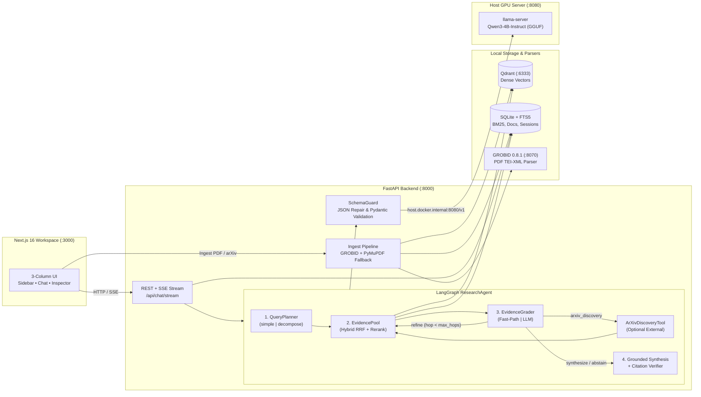

# AI Research Assistant — Citation-Grounded Agentic RAG

A **100% local-first** academic research workspace engineered to run within a **4 GB GPU VRAM budget**. The system combines **Hybrid Retrieval** (Qdrant Dense Vectors + SQLite FTS5 BM25 + Reciprocal Rank Fusion), **Cross-Encoder Reranking**, and a **Cyclic LangGraph Agent** with **Deterministic Citation Verification** and **Real-Time SSE Streaming**.

---

## 1. Overview & Key Features

- **Strict 4 GB VRAM Hardware Partitioning**:
  - **GPU**: Dedicated exclusively to quantized `Qwen3-4B-Instruct` served via `llama.cpp` (`llama-server` OpenAI-compatible API).
  - **CPU (ONNX Runtime / FastEmbed)**: Runs `BAAI/bge-small-en-v1.5` embeddings and `Xenova/ms-marco-MiniLM-L-6-v2` cross-encoder reranking with zero GPU memory contention.
- **Structure-Aware Academic Ingestion**:
  - Parses scientific PDFs and arXiv preprints through **GROBID 0.8.1** (TEI-XML section hierarchy extraction with automatic PyMuPDF fallback), preserving section headers and chunk provenance.
- **Hybrid Search + Cross-Encoder Reranking**:
  - Combines semantic dense search (**Qdrant**) and exact lexical keyword matching (**SQLite FTS5 BM25**) via **Reciprocal Rank Fusion (RRF, $k=60$)**, followed by cross-encoder relevance filtering.
- **Cyclic LangGraph Research Agent**:
  - **Coreference-Aware `QueryPlanner`**: Routes questions into `simple` (single sub-query) or `decompose` (up to 3 aspect-targeted sub-queries for comparative multi-paper synthesis).
  - **Interleaved `EvidencePool`**: Prevents a single high-scoring paper from crowding out evidence from other papers during comparative queries.
  - **Deterministic Fast-Path + LLM `EvidenceGrader`**: Skips extra LLM calls when cross-encoder scores already satisfy sufficiency thresholds; otherwise triggers bounded multi-hop query refinement or optional **arXiv live discovery**.
- **Deterministic Citation Verification & Strict Abstention**:
  - Post-generation `verify_and_extract_citations` validates every inline `[k]` marker against retrieved chunks, stripping out-of-range references (`0%` invalid citations emitted in final answers) and abstaining explicitly when premises are unsupported by the corpus.
- **Persistent Session Memory & 3-Column Research Workspace**:
  - SQLite-backed multi-turn sessions, FastAPI **Server-Sent Events (`/api/chat/stream`)** streaming live LangGraph node execution (`plan` → `retrieve` → `grade` → `synthesize`), and a **Next.js** 3-column academic UI with interactive `[k]` citation inspection.

---

## 2. System Architecture



---

## 3. Evaluation & Ablation Benchmarks (`rag_golden_v1`)

Evaluated end-to-end on **`rag_golden_v1`** (**60 curated samples** across **10 foundational LLM/RAG arXiv papers** in topic `llm_eval_v1`: *Transformer, FlashAttention, PagedAttention/vLLM, LoRA, QLoRA, RAG, Self-RAG, GraphRAG, ReAct, Toolformer*), spanning 5 categories: `factoid` (15), `conceptual` (15), `cross_lingual_vi` (12), `multi_paper` (8), and adversarial `unanswerable` (10).

### 3.1. Overall Ablation Comparison (60 Samples)

*Source: [`evals/baselines/phase4_baseline.md`](evals/baselines/phase4_baseline.md) & [`evals/baselines/phase5_agentic_baseline.md`](evals/baselines/phase5_agentic_baseline.md)*

| Mode | Samples | DocRec@Pre | DocRec@Post | EvHit@Post | MRR@Post | NDCG@Post | Grounded | Abstain F1 | False Refusal | Leak Rate | p50 Latency |
| :--- | :---: | :---: | :---: | :---: | :---: | :---: | :---: | :---: | :---: | :---: | :---: |
| `dense_only` | 60 | 100.0% | 92.9% | 56.1% | 0.586 | 0.620 | 76.0% | 0.581 | 24.0% | 10.0% | 4,163 ms |
| `hybrid_rrf` | 60 | 100.0% | 95.9% | 70.2% | 0.705 | 0.740 | 90.0% | 0.800 | 10.0% | 0.0% | 6,436 ms |
| `full_rag` *(Single-Shot)* | 60 | 100.0% | 98.0% | 67.8% | 0.715 | 0.739 | 90.0% | 0.800 | 10.0% | 0.0% | 7,222 ms |
| `agentic_rag` *(LangGraph)* | 60 | 99.0% | 96.9% | 70.1% | 0.713 | 0.729 | 86.0% | 0.692 | 14.0% | 10.0% | 12,215 ms |

### 3.2. Multi-Paper Comparative Synthesis (`multi_paper`, $n = 8$)

Single-shot top-$k$ retrieval struggles when one paper dominates reranker scores and crowds out the second paper. Query decomposition + interleaved sub-query pooling in `agentic_rag` substantially improves multi-document coverage and grounded synthesis:

| Mode | `multi_paper` Grounded Rate | `multi_paper` DocRec@Post | `multi_paper` EvHit@Post | `multi_paper` MRR@Post |
| :--- | :---: | :---: | :---: | :---: |
| `dense_only` | 62.5% | 68.8% | 50.0% | 0.729 |
| `hybrid_rrf` | 75.0% | 75.0% | 60.4% | 0.760 |
| `full_rag` *(Single-Shot)* | 62.5% | 87.5% | 50.0% | 0.656 |
| **`agentic_rag`** | **87.5%** *(+25.0 pp vs `full_rag`)* | **93.8%** *(+6.3 pp vs `full_rag`)* | **53.1%** | **0.573** |

### 3.3. Agentic Workflow Telemetry & Engineering Trade-offs

| Metric | Value (`agentic_rag`) | Engineering Note |
| :--- | :---: | :--- |
| **Route Split (`simple` / `decompose`)** | `37` / `22` | Planner decomposes comparative & multi-aspect queries while keeping single-paper lookups lightweight. |
| **Fast-Path Grader Activations** | `35` / `59` (~59.3%) | Deterministic score check bypasses LLM grading when cross-encoder evidence is already strong. |
| **Multi-Hop Refinements (`>1` hop)** | `7` | Triggered only when initial retrieval misses required query aspects. |
| **Average Hops / Average LLM Calls** | `1.12` / `2.34` | Bounded self-correction prevents runaway agent loops on a 4 GB local GPU. |
| **Stage p50 Latency (`Retrieve` / `Generate` / `Total`)** | `4,889 ms` / `4,716 ms` / `12,215 ms` | Trade-off: ~1.69× p50 latency vs `full_rag` (`7,222 ms`) and occasional 4B JSON schema sensitivity (`1` schema validation error, `14.0%` false refusal), exposed transparently via the UI toggle between **Agentic RAG** and **Single-Shot RAG**. |

---

## 4. Quickstart (Docker Compose — 1 Command)

### Step 1: Start `llama-server` on the Host GPU
Run `llama-server` bound to **`0.0.0.0`** (not `127.0.0.1`) so the `backend` container can reach the host inference server via `host.docker.internal:8080`:

```bash
llama-server \
  -m /path/to/Qwen3-4B-Instruct-Q4_K_M.gguf \
  --alias qwen3-4b-instruct \
  --host 0.0.0.0 \
  --port 8080 \
  -c 8192 \
  -ngl 99
```

> **Linux / Fedora Host Notes:**
> - **Why `--host 0.0.0.0`?** On Linux, `host.docker.internal` resolves to the Docker bridge gateway IP (e.g., `172.17.0.1`), so a service listening only on `127.0.0.1` will reject container connections.
> - **Firewall (`firewalld`)**: If `backend` reports `local_llm_ok: false` on Fedora/RHEL, allow port `8080/tcp` from the Docker bridge interface (`sudo firewall-cmd --zone=trusted --add-interface=docker0` or `--add-port=8080/tcp`).
> - **SELinux**: If SELinux is in `Enforcing` mode and blocks `./data:/app/data` bind writes, append `:Z` to the bind mount (`./data:/app/data:Z`) in `docker-compose.yml`.

### Step 2: Launch the Full 4-Service Stack
*(If you previously ran Qdrant/GROBID via `docker/docker-compose.yml`, stop the old containers first **without** `-v` so container names do not collide while keeping the existing `docker_qdrant_storage` volume intact: `docker compose -f docker/docker-compose.yml down`.)*

```bash
docker compose up --build -d
```

### Step 3: Open the Workspace
- **Research Workspace UI (Next.js)**: http://localhost:3000
- **Backend OpenAPI / Swagger UI**: http://localhost:8000/docs
- **Health Probe**: http://localhost:8000/api/health

---

## 5. Local Development & Testing

### Backend (Python 3.13 + `uv`)
```bash
# Install dependencies (including dev tools)
uv sync --dev

# Start Qdrant & GROBID only, then run FastAPI with hot reload
docker compose up -d qdrant grobid
uv run uvicorn ai_research_assistant.api.main:app --reload --host 0.0.0.0 --port 8000
```

### Frontend (Node.js 20+ / Next.js)
```bash
cd frontend
cp .env.example .env.local
npm install
npm run dev
```

### Quality Gates & Unit Tests (CPU-only, CI-identical)
```bash
uv run ruff check src tests scripts
uv run mypy src
uv run pytest -m "not gpu" -v

cd frontend && npm run lint && npx tsc --noEmit && npm run build
```

### Reproducing Evaluation Benchmarks
```bash
# Validate golden dataset integrity
uv run python scripts/validate_dataset.py

# Run single mode or full ablation suite (dense_only, hybrid_rrf, full_rag, agentic_rag)
uv run python scripts/run_eval.py --mode agentic_rag
uv run python scripts/run_eval.py --mode all --ingest-corpus
```

---

## 6. API Endpoints & Project Structure

### REST & SSE Endpoints

| Method | Endpoint | Description |
| :--- | :--- | :--- |
| `GET` | `/api/health` | Probes SQLite, Qdrant, GROBID, and local `llama-server` health + document counts. |
| `GET` / `POST` | `/api/topics` | Lists or creates research topics (with indexed document counts). |
| `GET` | `/api/documents` | Lists indexed documents (filterable via `?topic_id=...`). |
| `POST` | `/api/documents/ingest-arxiv` | Downloads, parses (GROBID/PyMuPDF), chunks, and indexes a paper by arXiv ID. |
| `POST` | `/api/documents/upload` | Multipart `.pdf` upload + end-to-end indexing (`file`, `topic_id`, `force`). |
| `GET` / `POST` | `/api/sessions` | Lists or creates persistent research chat sessions. |
| `PATCH` / `DELETE` | `/api/sessions/{session_id}` | Renames session title or deletes a session and its messages. |
| `GET` | `/api/sessions/{session_id}/messages` | Retrieves full message history including `citations` and `agent_trace`. |
| `POST` | `/api/chat` | Synchronous grounded RAG / Agentic RAG turn (`mode`: `agentic` \| `single_shot`). |
| `POST` | `/api/chat/stream` | **SSE streaming** (`session` → real-time `step` telemetry → `final` / `error`). |

### Repository Layout

```text
ai-research-assistant/
├── src/ai_research_assistant/
│   ├── agent/              # LangGraph ResearchAgent, QueryPlanner, EvidencePool, EvidenceGrader, ArXiv tool
│   ├── api/                # FastAPI app, dependency container, Pydantic schemas & REST/SSE routes
│   ├── db/                 # SQLiteStore (FTS5 BM25 + sessions + docs) & Qdrant VectorStore
│   ├── eval/               # Dataset loader, EvalRunner, LLM-as-a-Judge & Markdown/JSON reporters
│   ├── harness/            # Local/Cloud LLMRouter & SchemaGuard (JSON repair + structured validation)
│   ├── pipelines/          # GROBID/PyMuPDF parsers, section-aware chunker, FastEmbed & IngestPipeline
│   ├── rag/                # ContextBuilder, RAGEngine & deterministic citation verification
│   ├── retrieval/          # QueryRewriter, HybridRetriever (RRF) & CrossEncoderReranker
│   └── config.py           # Typed Pydantic Settings
├── frontend/               # Next.js (App Router, TypeScript strict, Tailwind CSS) 3-column UI
│   ├── src/components/     # Sidebar, ResearchWorkspace, MessageBubble, InspectorPanel, AddPaperModal
│   ├── src/lib/api.ts      # Typed REST client & chunk-safe SSE stream parser
│   ├── src/types/api.ts    # Frontend TypeScript contracts matching backend schemas
│   └── Dockerfile          # Multi-stage Next.js standalone production image
├── evals/
│   ├── datasets/           # rag_golden_v1.json (60 benchmark samples across 10 arXiv papers)
│   └── baselines/          # Phase 4 & Phase 5 ablation benchmark reports
├── scripts/                # run_eval.py & validate_dataset.py CLI utilities
├── tests/                  # Unit & API test suites (CPU/mock-safe via -m "not gpu")
├── Dockerfile.backend      # Multi-stage uv + Python 3.13 slim backend image
├── docker-compose.yml      # Full 4-service stack (qdrant, grobid, backend, frontend)
└── .github/workflows/ci.yml
```
